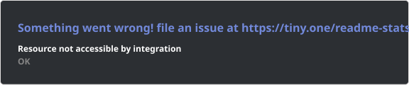

<h1 data-importer="text" align="center">Levi Vieira | Estudante Dev FullStack🖥️ </></h1>

###

<h6 data-importer="text" align="left">Desenvolvedor em formação | Graduado em ADS & Técnico em Informática pelo SENAI. 🛠️ Tech Stack: C#, Java, JavaScript, React, JSF, Hibernate, PostgreSQL, Git e AWS. 💼 Bagagem Profissional: Vivência na área financeiro-administrativa utilizando SAP. 🎯 Objetivo: Oportunidade no mercado de TI para aplicar competências técnicas e analíticas.</h6>

###

  
  
  
  
  
  

###

  
  
  
  
  
  
  
  
  
  
  
  
  
  
  
  
  
  
  
  
  
  
  
  
  
  
  
  
  

###

    
    
    
  

###

<picture data-importer="pacman">
  <source media="(prefers-color-scheme: dark)" srcset="https://raw.githubusercontent.com/LeviDeveloper-tech/LeviDeveloper-tech/pacman-output/pacman-contribution-graph-dark.svg?game=pacman">
  <source media="(prefers-color-scheme: light)" srcset="https://raw.githubusercontent.com/LeviDeveloper-tech/LeviDeveloper-tech/pacman-output/pacman-contribution-graph.svg?game=pacman">
  
</picture>

###
